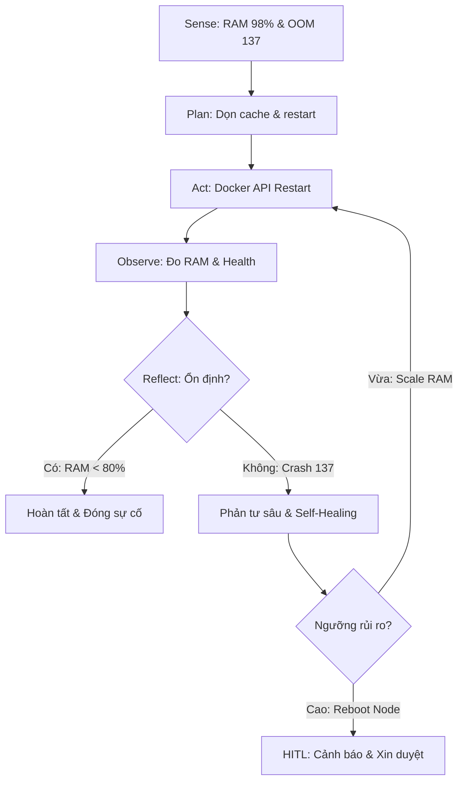

# BÁO CÁO PHÂN TÍCH VÒNG LẶP PHẢN HỒI AGENTIC LOOP TẠI FPT SOFTWARE

- **Mã bài tập:** `AI301_S01_BTVN_M2_BT1`
- **Học phần:** AI301 - AI Agent
- **Hệ thống:** CI/CD & IT Helpdesk FPT Software

---

## 1. Mô hình hóa 5 bước Agentic Loop xử lý lỗi Out of Memory

Đối với sự cố: `Server staging-node-04: Memory usage 98%, Docker container billing_service status: Exited (137) Out of Memory`, vòng lặp tự chủ của Agent vận hành qua 5 bước:

1. **Sense (Nhận thức):** Thu nhận telemetry từ Prometheus và Docker daemon. Agent bóc tách metric RAM host 98% và container tắt mã `137`. Agent xác định mã 137 là tín hiệu `SIGKILL` do Linux OOM-Killer kích hoạt nhằm bảo vệ máy chủ.
2. **Plan (Lập kế hoạch):** Đánh giá dịch vụ thanh toán gặp lỗi, Agent lập kế hoạch phục hồi: trích xuất 100 dòng log cuối, dọn cache đệm máy chủ và kích hoạt khởi động lại container.
3. **Act (Hành động):** Gọi Docker API trích xuất log lưu hồ sơ sự cố, dọn dẹp bộ nhớ đệm và thực thi `docker restart billing_service`.
4. **Observe (Quan sát):** Theo dõi phản hồi: thăm dò trạng thái container trong 60 giây, đo lại RAM host và gửi HTTP probe kiểm tra endpoint `GET /health`.
5. **Reflect (Phản tư):** Đối chiếu dữ liệu quan sát với tiêu chuẩn (Healthy, RAM < 80%). Nếu phục hồi thành công, đóng sự cố; nếu dịch vụ tái crash, kích hoạt phản tư nâng cao.

## 2. Cơ chế Phản tư (Reflection) và Tự phục hồi khi Container tái Crash

Khi container `billing_service` chạy lại 45 giây rồi tiếp tục `Exited (137)` lần 2, Agent tự điều chỉnh:

* **Phản tư nguyên nhân gốc (Root-Cause Reflection):** Khởi động lại đơn thuần thất bại. Sự cố không phải nghẽn tức thời mà do rò rỉ bộ nhớ (memory leak) hoặc batch job quá tải khi nạp dữ liệu. Agent chủ động hủy chu kỳ restart nhằm tránh vòng lặp CrashLoopBackOff.
* **Tự phục hồi thích ứng (Adaptive Self-Healing):**
  * *Bước 1 - Thu thập dữ liệu chẩn đoán:* Trích xuất nhanh Thread Dump và Heap Profile lưu hồ sơ sự cố.
  * *Bước 2 - Điều chỉnh tài nguyên động:* Chạy lệnh `docker update --memory 4g billing_service` nâng tạm RAM từ 2GB lên 4GB nếu host còn bộ nhớ an toàn.
  * *Bước 3 - Điều tiết luồng dữ liệu:* Tạm dừng Message Queue tiêu thụ tác vụ nặng trong 5 phút để container ổn định trước khi xử lý tải dồn.

## 3. Ranh giới can thiệp của con người (Human-in-the-Loop - HITL)

Ma trận phân quyền xác định ranh giới tự chủ và điểm dừng bắt buộc:

| Phân vùng | Quyền hạn Agent | Điều kiện áp dụng |
| :--- | :--- | :--- |
| **Tự chủ (Autonomous)** | Tự thực thi | - Thu thập log, đo metrics, dọn cache rác. - Restart container tối đa 02 lần. - Cấp thêm RAM tạm thời khi host còn > 10% RAM trống. - Tạm dừng hàng đợi xử lý dưới 10 phút. |
| **Bắt buộc duyệt (HITL)** | Chặn lại, xin duyệt | - Khởi động lại toàn bộ máy chủ (`reboot node`). - Xóa Docker Volume hoặc can thiệp dữ liệu gốc. - Tự phục hồi 2 lần thất bại nhưng container vẫn sập. - RAM máy chủ vượt 95% đe dọa các node lân cận. |

Khi chạm ngưỡng HITL, Agent đóng băng can thiệp sâu, gửi tóm tắt nguyên nhân qua Slack/Telegram của kỹ sư trực kèm 2 lựa chọn: `[Duyệt Restart Node]` hoặc `[Rollback CI/CD]`, đảm bảo con người nắm quyền kiểm soát tối hậu.

