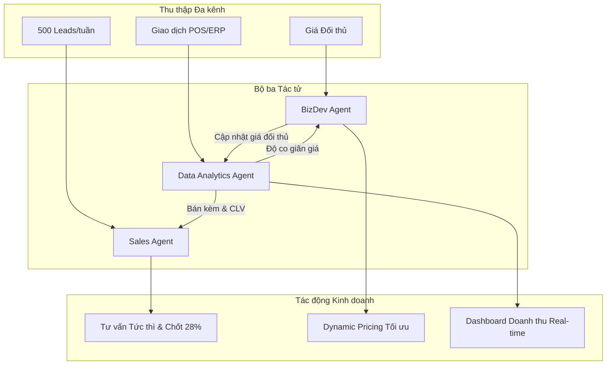

# ĐỀ ÁN BỘ BA TÁC TỬ CHUYÊN TRÁCH CHO TẬP ĐOÀN BÁN LẺ ĐIỆN MÁY

- **Đơn vị tư vấn:** FPT Digital
- **Mã đề án:** `AI301_S01_BTVN_M3_BT1` (Session 01)
- **Doanh nghiệp:** Tập đoàn Bán lẻ Điện máy

---

## 1. Bối cảnh và Ma trận nhiệm vụ bộ ba Agent chuyên trách

Khảo sát hiện trạng chỉ ra 3 điểm nghẽn: 500 Leads/tuần mất 2 ngày phân loại; giá đối thủ đổi liên tục nhưng 1 tháng mới cập nhật; và báo cáo tuần mất 3 ngày tổng hợp Excel. Nhằm xóa 60% thời gian lãng phí, FPT Digital đề xuất mô hình bộ ba tác tử:

| Tác tử | Bài toán cốt lõi | Dữ liệu đầu vào | Sản phẩm đầu ra |
| :--- | :--- | :--- | :--- |
| **Sales Agent** | Xử lý 500 Leads/tuần; chấm điểm và phản hồi dưới 5 phút. | Form web, clickstream, CRM, tồn kho real-time. | Hot Leads kèm kịch bản chào hàng, tin nhắn Zalo/SMS, lịch hẹn tư vấn. |
| **BizDev Agent** | Xóa trễ 1 tháng theo dõi giá; cào dữ liệu biến động giá đối thủ. | Scraping giá website đối thủ (Điện máy Xanh, Shopee), tin ngành. | Dashboard cảnh báo biến động giá real-time, đề xuất giá bán và báo cáo tuần. |
| **Data Analytics Agent** | Triệt tiêu 3 ngày làm báo cáo Excel; tự động hợp nhất và dự báo nhu cầu. | Giao dịch POS/ERP thời gian thực, chi phí, tồn kho chuỗi. | Báo cáo doanh thu real-time, phân tích giỏ hàng, cảnh báo tồn kho chậm luân chuyển. |

## 2. Chuỗi giá trị tích hợp và Sơ đồ phối hợp dữ liệu đa tác tử

Data Analytics Agent đóng vai trò là hạt nhân dữ liệu (Single Source of Truth), cung cấp số liệu định lượng giúp Sales Agent và BizDev Agent ra quyết định chuẩn xác:

* **Từ Data Analytics Agent sang Sales Agent:** Qua mô hình giỏ hàng và giá trị vòng đời khách hàng (CLV), Data Analytics Agent gửi danh mục bán kèm tối ưu (Next-Best-Action). Khi có Lead mới quan tâm Smart TV, Sales Agent tự động gợi ý thêm bảo hành và loa soundbar phù hợp ngân sách, nâng tỷ lệ chốt đơn từ 12% lên 28%.
* **Từ Data Analytics Agent sang BizDev Agent:** Data Analytics Agent liên tục đo độ co giãn giá (Price Elasticity) và biên lợi nhuận từng SKU. Khi BizDev Agent phát hiện đối thủ giảm 8% giá máy giặt, hệ thống lập tức chạy mô phỏng lợi nhuận, giúp BizDev Agent giữ giá nhưng tặng thêm voucher dịch vụ để bảo vệ lợi nhuận.

## 3. So sánh 3 nền tảng triển khai và Khuyến nghị kiến trúc FPT Digital

FPT Digital tiến hành đánh giá 3 nền tảng AI Agent hàng đầu:

| Tiêu chí | Google Antigravity | OpenAI Assistants / ChatGPT | Claude Anthropic (Claude 3.5 Sonnet) |
| :--- | :--- | :--- | :--- |
| **Điểm mạnh** | Điều phối tác tử tự chủ, quản lý trạng thái bền vững, sandbox an toàn cao. | Hội thoại bán hàng tự nhiên, API phong phú, phản hồi nhanh. | Context lớn (200K tokens), suy luận logic mạnh, trích xuất web chuẩn xác. |
| **Điểm yếu** | Yêu cầu workspace chuẩn hóa, phụ thuộc công cụ nội bộ. | Context hạn chế với file lớn, chi phí API tăng nhanh khi truy vấn cao. | Streaming chậm hơn đôi chút, plugin tích hợp ít hơn OpenAI. |
| **Chi phí** | Tối ưu chi phí doanh nghiệp, hybrid linh hoạt theo tài nguyên. | Tính phí theo token ($2.5 - $10/1M tokens), biến động theo lead. | Chi phí token hợp lý ($3 - $15/1M tokens), tiết kiệm với tài liệu dài. |
| **Tác vụ phù hợp** | **Data Analytics Agent**: Orchestrator trung tâm quản trị dữ liệu và luồng xử lý chuỗi. | **Sales Agent**: Tương tác trực tiếp khách hàng đa kênh, phản hồi tự nhiên và chốt đơn. | **BizDev Agent**: Cào quét, phân tích báo cáo đối thủ và tổng hợp dữ liệu chiến lược. |

**Khuyến nghị triển khai tích hợp:** FPT Digital khuyến nghị mô hình kết hợp đa nền tảng (Multi-Provider Hybrid Architecture): ứng dụng **Google Antigravity** điều phối tổng thể và vận hành Data Analytics Agent; dùng **OpenAI API** cho giao tiếp mặt trước của Sales Agent; và tích hợp **Claude 3.5 Sonnet** cho công tác tình báo giá của BizDev Agent. Giải pháp giúp doanh nghiệp giải phóng 85% thời gian thủ công và tối ưu hóa lợi nhuận bền vững.
