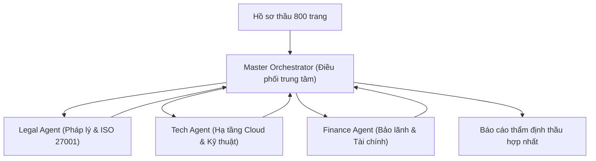

# THIẾT KẾ KIẾN TRÚC ĐA TÁC TỬ PHÂN CẤP (HIERARCHICAL MULTI-AGENT) TẠI VIETTEL

- **Mã bài tập:** `AI301_S08_BTVN_M1_BT1` (Session 08)
- **Hệ thống:** Hệ thống Đa tác tử thẩm định hồ sơ thầu
- **Đơn vị:** Tổng công ty Giải pháp Doanh nghiệp Viettel (Viettel Solutions)

---

## 1. Mô hình hóa kiến trúc phân cấp (Hierarchical Architecture)

Nhằm tối ưu hóa năng lực thẩm định các dự án chuyển đổi số quy mô lớn, Viettel Solutions thiết kế mô hình Đa tác tử phân cấp giúp phân rã và xử lý hồ sơ thầu 800 trang của dự án thành phố thông minh:

Master Orchestrator đóng vai trò là "Tổng công trình sư", trực tiếp phân rã tài nguyên, giao việc song song cho các Subagents chuyên trách và tổng hợp kết quả thẩm định cuối cùng.

## 2. Phân định ranh giới trách nhiệm và bộ công cụ (Toolset)

Mỗi tác tử thành viên hoạt động độc lập trong ranh giới chuyên môn nghiêm ngặt với bộ công cụ được cấp quyền rõ ràng:

| Tác tử (Agent) | Trách nhiệm cốt lõi | Bộ công cụ cho phép (Toolset) |
| :--- | :--- | :--- |
| **Master Orchestrator** | Phân tách hồ sơ 800 trang, phân bổ tác vụ, tổng hợp báo cáo và xử lý xung đột chéo. | `DocChunker`, `TaskDispatcher`, `ReportSynthesizer` |
| **Legal Agent** | Rà soát điều khoản hợp đồng, chế tài pháp lý và tiêu chuẩn an toàn thông tin ISO 27001. | `LegalPdfSearcher`, `ComplianceChecker`, `ClauseExtractor` |
| **Tech Agent** | Thẩm định năng lực máy chủ Viettel Cloud, kiến trúc phần mềm và cam kết SLA dịch vụ. | `CloudSpecEvaluator`, `DiagramParser`, `SlaBenchmarkTool` |
| **Finance Agent** | Kiểm tra bảo lãnh ngân hàng, chi phí đầu tư TCO và tính khả thi của dòng tiền dự án. | `BankGuaranteeValidator`, `ExcelModeler`, `CashFlowChecker` |

## 3. Quy tắc phân bổ công việc từ hồ sơ thầu 800 trang

Orchestrator áp dụng quy trình xử lý 3 giai đoạn tự động hóa cao:

1. **Phân đoạn ngữ nghĩa (Semantic Chunking & Routing):** Orchestrator quét mục lục hồ sơ thầu 800 trang, trích xuất từ khóa và chia tách tài liệu thành 3 gói dữ liệu độc lập: Pháp lý (250 trang), Kỹ thuật (350 trang), và Tài chính (200 trang).
2. **Thực thi phân tán song song (Parallel Execution):** Cả 3 Subagents nhận gói dữ liệu tương ứng và kích hoạt công cụ chuyên dụng cùng lúc. Phương pháp này giảm 65% thời gian xử lý và giải quyết triệt để rào cản tràn cửa sổ ngữ cảnh (Context Window Overflow).
3. **Giải quyết xung đột và Tổng hợp (Cross-Resolution & Synthesis):** Orchestrator thu hồi kết quả phân tích, tự động đối chiếu các mâu thuẫn liên phòng ban (ví dụ: Tech Agent đòi hỏi cấu hình máy chủ cao trong khi Finance Agent cắt giảm chi phí) và xuất bản báo cáo thẩm định hợp nhất hoàn chỉnh.
