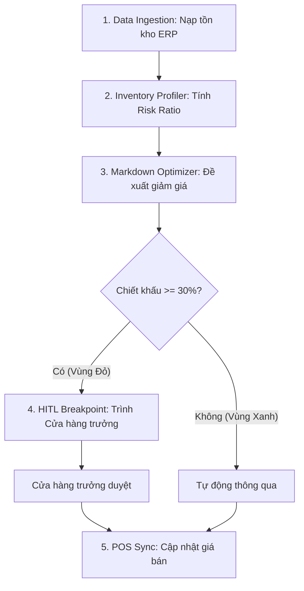

# BÁO CÁO TÍCH HỢP: CHUỖI THỰC THI LIÊN HOÀN (SKILL CHAINING) VÀ CƠ CHẾ HITL CHO MVP WINCOMMERCE

- **Mã bài tập:** `AI301_S09_BTVN_M3_BT1`
- **Học phần:** AI301 - AI Agent (Session 09: Xây dựng Business AI Agent MVP)
- **Đơn vị:** Chuỗi bán lẻ WinCommerce (Tập đoàn Masan)
- **Đồ án MVP:** Fresh Inventory Diagnostic Agent (Tự động chẩn đoán tồn kho tươi sống)

---

## 1. Kiến trúc Tổng thể Chuỗi Thực thi Liên hoàn (Skill Chaining Architecture)

Trong các hệ thống bán lẻ quy mô lớn như WinCommerce với hơn 3.600 siêu thị WinMart và WinMart+, việc quản trị tồn kho hàng thực phẩm tươi sống đòi hỏi tính tức thời, tự động hóa cao và kiểm soát rủi ro chặt chẽ. Trước đây, các bộ phận vận hành độc lập xử lý số liệu rời rạc qua file Excel, tạo ra độ trễ thông tin từ 3 đến 4 giờ mỗi sáng. Hệ thống Fresh Inventory Diagnostic MVP khắc phục triệt để rào cản này bằng mô hình chuỗi thực thi liên hoàn (Skill Chaining), kết nối liền mạch từ khâu nạp dữ liệu thô, phân tích rủi ro, tối ưu hóa chính sách giá đến đồng bộ đa kênh:



Mô hình chuỗi giúp dữ liệu luân chuyển mượt mà qua các trạm xử lý chuyên biệt. Mỗi kỹ năng đảm nhận một nhiệm vụ độc lập, giúp ngăn chặn hiện tượng nghẽn mạch dữ liệu, triệt tiêu ảo giác thông tin và đảm bảo toàn bộ quy trình hoàn tất trong vòng 3 phút trước giờ mở cửa.

---

## 2. Nhiệm vụ 1: Thiết lập Cơ chế Chuyển giao Dữ liệu (Hand-off Contract Schema)

Để loại bỏ hoàn toàn hiện tượng thất thoát ngữ cảnh hoặc sai lệch kiểu dữ liệu khi chuyển giao giữa các mắt xích, Orchestrator ban hành Khế ước Bàn giao Dữ liệu chuẩn mực theo JSON Schema Draft-07:

```json
{
  "$schema": "http://json-schema.org/draft-07/schema#",
  "title": "FreshInventoryHandoffPayload",
  "type": "object",
  "properties": {
    "store_id": { "type": "string", "pattern": "^WM_[A-Z0-9_]+$" },
    "execution_time": { "type": "string" },
    "analyzed_skus": {
      "type": "array",
      "items": {
        "type": "object",
        "properties": {
          "sku_id": { "type": "string" }, "current_stock": { "type": "number", "minimum": 0 },
          "hours_to_expire": { "type": "number" }, "risk_category": { "type": "string", "enum": ["CRITICAL", "SLOW_MOVING", "HEALTHY"] },
          "discount_rate": { "type": "number", "minimum": 0, "maximum": 0.5 }, "discounted_price": { "type": "number" }
        },
        "required": ["sku_id", "risk_category", "discount_rate", "discounted_price"]
      }
    }
  },
  "required": ["store_id", "execution_time", "analyzed_skus"]
}
```

Khế ước kiểm soát khắt khe các thuộc tính số học và phân loại rủi ro. Mắt xích tiếp theo chỉ được kích hoạt khi gói tin vượt qua 100% các tiêu chí kiểm định, ngăn chặn dữ liệu rác lan truyền vào hệ thống định giá bán lẻ.

---

## 3. Nhiệm vụ 2: Cài đặt Điểm dừng Phê duyệt HITL trên Google Antigravity

Trong vận hành chuỗi siêu thị, quyết định giảm giá bán ảnh hưởng trực tiếp đến doanh thu và uy tín thương hiệu. Vì vậy, hệ thống thiết lập Điểm dừng Phê duyệt (**Approval Breakpoint**) tại ranh giới Vùng Đỏ nhằm đảm bảo sự kiểm soát tối cao của con người:

- **Logic kích hoạt Điểm dừng:** Khi phát hiện bất kỳ mặt hàng nào có mức chiết khấu đề xuất từ 30% trở lên hoặc giá trị lô hàng xả kho vượt quá 5.000.000 VNĐ, Orchestrator lập tức ngắt luồng tự động và chuyển máy trạng thái sang `SUSPENDED_WAITING_APPROVAL`.
- **Cấu hình trên Google Antigravity:** Cơ chế được thực thi thông qua thuộc tính Artifact Metadata `RequestFeedback: true`. Tác tử tự động tạo Phiếu Trình Duyệt Xả Hàng tương tác, hiển thị trực quan mã mặt hàng, số lượng tồn thực tế, số giờ hết hạn còn lại và mức giá sau chiết khấu.
- **Khóa quyền tự động & Tương tác 2 chiều:** Proposal Agent bị tạm ngưng toàn bộ quyền gửi dữ liệu sang hệ thống POS. Hệ thống hỗ trợ 2 chế độ tương tác: phê duyệt nhanh bằng nút bấm hoặc nhận chỉ thị bằng ngôn ngữ tự nhiên để điều chỉnh biên độ giảm giá tức thì trước khi chốt biểu giá.

---

## 4. Nhiệm vụ 3: Nhật ký Thực nghiệm Chuỗi Liên hoàn Toàn diện (Execution Trace)

Nhật ký ghi nhận thực tế luồng thực thi của Agent trên môi trường Google Antigravity tại cửa hàng WinMart Times City:

```text
[06:00:01] [ORCHESTRATOR] Bắt đầu phiên chẩn đoán tồn kho tươi sống tại điểm bán WM_HN_TIMES_CITY.
[06:00:08] [TOOL_CALL] Ingestor nạp 120 SKU từ kho ERP qua giao thức MCP Read-only.
[06:00:22] [TOOL_CALL] Profiler tính Risk Ratio: Phát hiện 08 SKU nhóm CRITICAL (hạn dùng dưới 24h).
[06:00:36] [TOOL_CALL] Optimizer đề xuất giảm giá 50% cho SKU-THIT-BO-UC (hết hạn trong 8h).
[06:00:40] [BREAKPOINT] Chiết khấu 50% >= 30%: Chuyển trạng thái SUSPENDED_WAITING_APPROVAL.
[06:00:45] [ARTIFACT] Xuất Phiếu duyệt xả hàng cận date (RequestFeedback=True). Luồng tạm dừng.
[06:01:50] [USER_INPUT] Cửa hàng trưởng duyệt: "Đồng ý giảm giá 50% xả hàng thịt bò Úc chiều nay."
[06:01:53] [RESUME] Orchestrator tiếp nhận lệnh phê duyệt. Mở khóa Vùng Đỏ thành công.
[06:02:05] [TOOL_CALL] POS Publisher đồng bộ biểu giá mới lên máy tính tiền và báo quầy tươi sống.
[06:02:12] [SUCCESS] Chuỗi thực thi liên hoàn kết thúc thành công. Tổng thời gian: 2 phút 11 giây.
```

---

## 5. Đánh giá Hiệu quả Vận hành và Giá trị Nghiệp vụ tại WinCommerce

Việc tích hợp chuỗi thực thi liên hoàn với điểm dừng phê duyệt HITL mang lại những lợi ích chiến lược toàn diện:

1. **Rút ngắn chu kỳ vận hành:** Cắt giảm thời gian phân tích tồn kho từ 4 giờ thủ công xuống dưới 3 phút mỗi sáng, giúp điểm bán chủ động dán tem giảm giá trước giờ cao điểm mua sắm.
2. **Quản trị rủi ro tuyệt đối:** Điểm dừng HITL bảo vệ biên lợi nhuận của siêu thị, đảm bảo không có bất kỳ lệnh giảm giá lớn nào được kích hoạt mà thiếu sự chuẩn thuận của quản lý.
3. **Hiệu quả kinh tế bền vững:** Dự kiến hạ tỷ lệ hủy hàng tươi sống tại 50 cửa hàng thử nghiệm từ 6.8% xuống dưới 3.5%, tiết kiệm hàng chục tỷ đồng chi phí hao hụt mỗi năm cho chuỗi WinCommerce.
