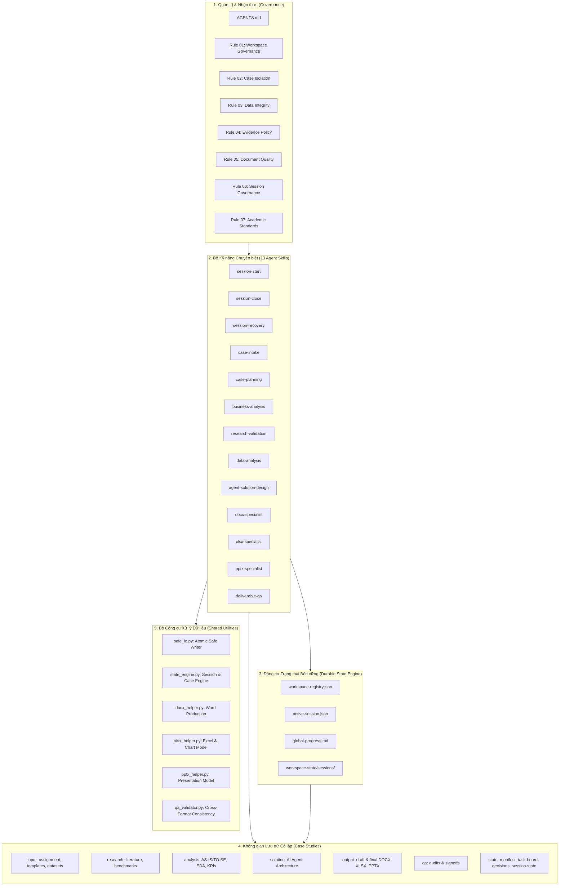

# KIẾN TRÚC HỆ THỐNG WORKSPACE (WORKSPACE ARCHITECTURE)

**Phiên bản kiến trúc:** 1.0.0  
**Tác giả:** AI Workspace Architect  
**Workspace Root:** `D:\antigravity\AI-Agent PJ`

---

## 1. Sơ đồ Kiến trúc Tổng thể (Architecture Diagram)

---

## 2. Mô hình Quản lý Trạng thái Bền vững (Durable State Model)

Hệ thống hoạt động độc lập hoàn toàn với ngữ cảnh hội thoại tạm thời (Conversation Context) nhờ lưu trữ trạng thái xuống ổ cứng:

1. **Workspace Registry (`workspace-state/workspace-registry.json`):**
   - Lưu trữ danh mục toàn bộ các bài tập case study trong Workspace.
   - Quản lý mã case hiện hành (`active_case_id`), ngày tạo, ngày cập nhật và phiên gần nhất.
2. **Active Session Pointer (`workspace-state/active-session.json`):**
   - Con trỏ phiên đang hoạt động toàn cục.
   - Cho phép phát hiện ngay lập tức tình trạng treo/gián đoạn phiên nếu Antigravity bị đóng đột ngột.
3. **Case Manifest (`cases/<CASE_ID>/state/case-manifest.json`):**
   - Hồ sơ định danh của case: Yêu cầu đề bài, danh sách sản phẩm bàn giao kỳ vọng, mã phiên đang active.
4. **Task Board Kanban (`cases/<CASE_ID>/state/task-board.md`):**
   - Bảng theo dõi tiến độ công việc với 5 cột chuẩn: `TODO`, `IN_PROGRESS`, `BLOCKED`, `REVIEW`, `DONE`.
5. **Session State & History (`cases/<CASE_ID>/state/session-state.json` & `sessions/`):**
   - Lưu trữ nhật ký chi tiết từng phiên làm việc, các quyết định (`decisions`), rào cản (`issues`), tệp tin kết quả (`artifacts`) và kế hoạch phiên tiếp theo.

---

## 3. Giao thức An toàn Tệp tin trên Windows (Safe Atomic File Write)

Nhằm triệt tiêu rủi ro hỏng tệp tin do xung đột khóa tệp (File Lock) trên hệ điều hành Windows NTFS:
- Mọi thao tác ghi tệp JSON/Markdown đều thông qua hàm `atomic_write_text()` / `atomic_write_json()` trong `safe_io.py`.
- Dữ liệu được ghi trước vào tệp tạm thời `.tmp` trong cùng thư mục, thực hiện `flush()` và `os.fsync()`, sau đó áp dụng lệnh thay thế nguyên tử `os.replace()` với cơ chế thử lại tự động (retry loop 5 lần).
- Đảm bảo trạng thái hệ thống luôn toàn vẹn ngay cả khi mất điện hoặc dừng chương trình đột ngột.

---

## 4. Cơ chế Đảm bảo Chất lượng Đa định dạng (Cross-Format Consistency)

Khi hoàn thành cả 3 định dạng tài liệu:
- **Báo cáo Word:** Đóng vai trò tài liệu tư vấn chi tiết, giải trình cơ sở lý luận và kiến trúc.
- **Bảng tính Excel:** Đóng vai trò mô hình tài chính và bằng chứng tính toán số học có thể kiểm chứng độc lập.
- **Slide PowerPoint:** Đóng vai trò bản trình bày tóm lược dành cho ban lãnh đạo hoặc giảng viên chấm thi.
- **Chốt chặn QA Validator:** Quét tự động nội dung cả 3 tệp tin để đối chiếu các chỉ số quan trọng (ROI, Doanh thu, Chi phí tiết kiệm, Thời gian hoàn vốn). Đảm bảo không xảy ra sai lệch số liệu giữa các tài liệu.
